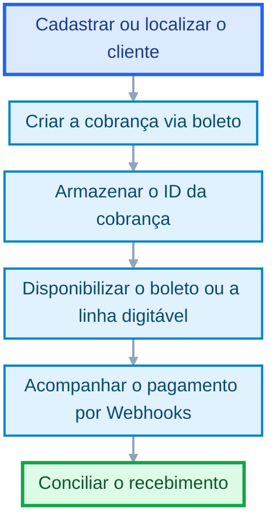

# Cobranças via boleto

Comece a aceitar pagamentos de boletos online com o Asaas.

Crie cobranças via boleto, disponibilize os dados de pagamento ao cliente e acompanhe o recebimento por Webhooks.

<Callout icon="??" theme="info">
  ### **Importante**

  Ao concluir este guia, você terá criado uma cobrança via boleto, obtido a linha digitável e preparado sua integração para acompanhar o pagamento.
</Callout>

<Embed title="" typeOfEmbed="youtube" url="https://www.youtube.com/watch?v=YCFgeFQwgJM" href="https://www.youtube.com/watch?v=YCFgeFQwgJM" html="%3Ciframe%20class%3D%22embedly-embed%22%20src%3D%22%2F%2Fcdn.embedly.com%2Fwidgets%2Fmedia.html%3Fsrc%3Dhttps%253A%252F%252Fwww.youtube.com%252Fembed%252FYCFgeFQwgJM%253Ffeature%253Doembed%26display_name%3DYouTube%26url%3Dhttps%253A%252F%252Fwww.youtube.com%252Fwatch%253Fv%253DYCFgeFQwgJM%26image%3Dhttps%253A%252F%252Fi.ytimg.com%252Fvi%252FYCFgeFQwgJM%252Fhqdefault.jpg%26key%3D7788cb384c9f4d5dbbdbeffd9fe4b92f%26type%3Dtext%252Fhtml%26schema%3Dyoutube%22%20width%3D%22854%22%20height%3D%22480%22%20scrolling%3D%22no%22%20title%3D%22YouTube%20embed%22%20frameborder%3D%220%22%20allow%3D%22autoplay%3B%20fullscreen%3B%20encrypted-media%3B%20picture-in-picture%3B%22%20allowfullscreen%3D%22true%22%3E%3C%2Fiframe%3E" />

## Quando utilizar

Utilize cobranças via boleto quando sua integração precisar:

* disponibilizar uma forma de pagamento com vencimento;
* apresentar a linha digitável ou o boleto em PDF;
* aplicar descontos, juros ou multas;
* gerar cobranças parceladas e carnês.

## Antes de começar

Você precisa:

1. cadastrar ou localizar o cliente;
2. armazenar o ID retornado pela API;
3. definir o valor e a data de vencimento;
4. configurar os Webhooks relacionados às cobranças.

Consulte: <Anchor target="_blank" href="https://docs.asaas.com/docs/criando-um-cliente">Cadastre clientes para criar cobranças</Anchor>.

## Como funciona



## 1. Crie a cobrança

Envie uma requisição para:

```http
POST /v3/payments
```

```json
{
  "customer": "cus_000005219613",
  "billingType": "BOLETO",
  "value": 100.00,
  "dueDate": "2027-01-15",
  "externalReference": "PEDIDO-123"
}
```

O campo `billingType` deve ser enviado como `BOLETO`.

<Anchor target="_blank" href="https://docs.asaas.com/reference/criar-nova-cobranca">Consulte o endpoint: Criar nova cobrança</Anchor>.

### Resultado esperado

A API retornará os dados da cobrança criada.

Armazene principalmente:

* `id`: identificador da cobrança;
* `invoiceUrl`: endereço da fatura;
* `bankSlipUrl`: endereço do boleto em PDF;
* `status`: situação atual da cobrança.

O `id` será utilizado nas próximas consultas e na conciliação do pagamento.

## 2. Obtenha a linha digitável

Para recuperar a linha digitável e o código de barras, utilize:

```http
GET /v3/payments/{id}/identificationField
```

<Anchor target="_blank" href="https://docs.asaas.com/reference/obter-linha-digitavel-do-boleto">Consulte o endpoint: Obter linha digitável do boleto</Anchor>.

Exemplo de resposta:

```json
{
  "identificationField": "00190000090275928800021932978170187890000005000",
  "nossoNumero": "6543",
  "barCode": "00191878900000050000000002759288002193297817"
}
```

<Callout icon="??" theme="warn">
  ### **Atenção**

  Se o valor ou o vencimento da cobrança for atualizado, recupere novamente a linha digitável antes de apresentá-la ao cliente.
</Callout>

## 3. Configure desconto, juros e multa

Essas condições devem ser informadas durante a criação da cobrança.

### Desconto

Para aplicar um desconto de 10% até cinco dias antes do vencimento, adicione:

```json
{
  "discount": {
    "value": 10,
    "dueDateLimitDays": 5,
    "type": "PERCENTAGE"
  }
}
```

### Juros e multa

Para aplicar juros de 1% e multa de 2% após o vencimento, adicione:

```json
{
  "interest": {
    "value": 1
  },
  "fine": {
    "value": 2
  }
}
```

Consulte a <Anchor target="_blank" href="https://docs.asaas.com/reference/criar-nova-cobranca">referência de criação de cobranças</Anchor> para verificar os formatos e limites aplicáveis.

Após o pagamento, os campos `originalValue` e `interestValue` podem ser utilizados para identificar diferenças entre o valor original e o valor recebido.

## 4. Acompanhe o pagamento

Configure Webhooks para receber as alterações de status da cobrança.

Os principais eventos desse fluxo são:

* `PAYMENT_CONFIRMED`;
* `PAYMENT_RECEIVED`;
* `PAYMENT_OVERDUE`;
* `PAYMENT_REFUNDED`.

Consulte:

* <Anchor target="_blank" href="https://docs.asaas.com/docs/webhooks-2">Configure Webhooks</Anchor>
* <Anchor target="_blank" href="https://docs.asaas.com/docs/webhook-para-cobrancas">Eventos de cobranças</Anchor>

Não libere produtos ou serviços considerando apenas a criação da cobrança. Aguarde a confirmação do pagamento.

## Cobrança parcelada e carnê

Para criar um parcelamento, informe `installmentCount` com `installmentValue` ou `totalValue`.

A resposta retornará o ID do parcelamento no campo `installment`.

Para obter o carnê em PDF, utilize:

```http
GET /v3/installments/{id}/paymentBook
```

O parâmetro `{id}` representa o ID do parcelamento.

Consulte:

* <Anchor target="_blank" href="https://docs.asaas.com/docs/criar-uma-cobranca-parcelada">Crie uma cobrança parcelada</Anchor>
* <Anchor target="_blank" href="https://docs.asaas.com/reference/gerar-carne-de-parcelamento">Gere o carnê do parcelamento</Anchor>

## QR Code Pix no boleto

Para exibir um QR Code Pix no PDF do boleto, mantenha uma chave Pix cadastrada na conta Asaas.

Consulte <Anchor target="_blank" href="https://docs.asaas.com/docs/cobrancas-via-pix">Cobranças via Pix</Anchor>.

## Erros comuns

Caso a cobrança não seja criada, verifique se:

* o cliente pertence à mesma conta;
* `billingType` foi enviado como `BOLETO`;
* o valor e o vencimento são válidos;
* a URL e a chave de API pertencem ao mesmo ambiente;
* os campos de desconto, juros ou multa estão corretos.

Em caso de timeout ou resposta inconclusiva, consulte as cobranças existentes antes de repetir a criação para evitar duplicidades.

## Próximos passos

* <Anchor target="_blank" href="https://docs.asaas.com/docs/guia-de-cobrancas">Conheça o fluxo de cobranças</Anchor>
* <Anchor target="_blank" href="https://docs.asaas.com/docs/criar-uma-cobranca-parcelada">Crie uma cobrança parcelada</Anchor>
* <Anchor target="_blank" href="https://docs.asaas.com/docs/cobrancas-via-pix">Crie cobranças via Pix</Anchor>
* <Anchor target="_blank" href="https://docs.asaas.com/docs/notificacoes">Configure notificações</Anchor>
* <Anchor target="_blank" href="https://docs.asaas.com/docs/webhooks-2">Configure Webhooks</Anchor>

# Sibling pages

* [Introdução - Cobranças](https://docs.asaas.com/docs/guia-de-cobrancas.md)
* [Cadastro de clientes](https://docs.asaas.com/docs/criando-um-cliente.md)
* [Cobranças via cartão de crédito](https://docs.asaas.com/docs/cobrancas-via-cartao-de-credito.md)
* [Criar uma cobrança parcelada](https://docs.asaas.com/docs/criar-uma-cobranca-parcelada.md)
* [Redirecionamento após o pagamento](https://docs.asaas.com/docs/redirecionamento-apos-o-pagamento.md)
* [Chargeback](https://docs.asaas.com/docs/chargeback.md)
* [Estornos](https://docs.asaas.com/docs/estornos.md)

# What’s Next

* [Cadastro de clientes](https://docs.asaas.com/docs/criando-um-cliente.md)