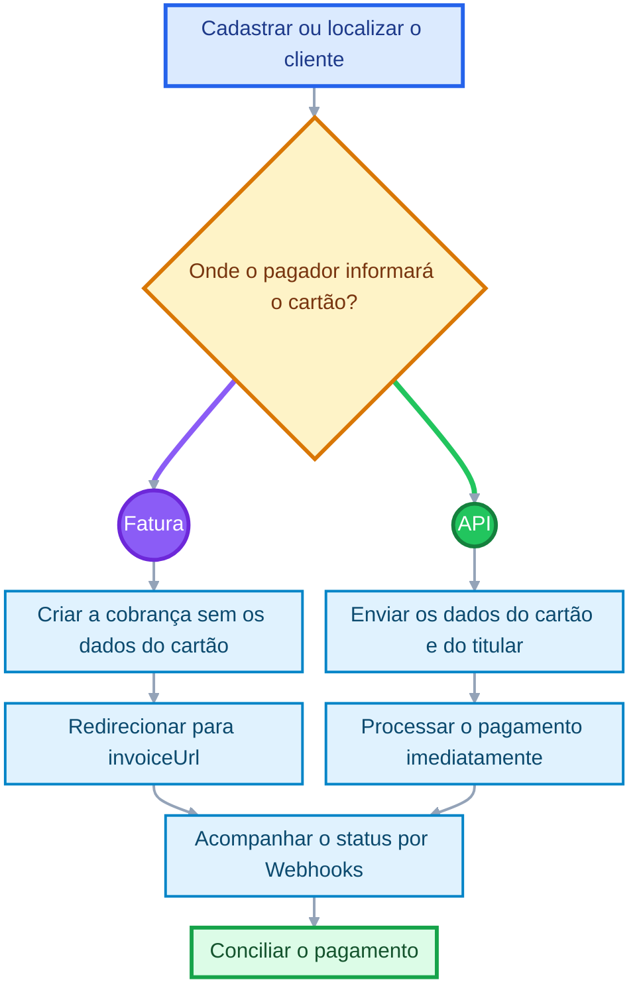

# Cobranças via cartão de crédito

Segurança e praticidade nas cobranças online.

Crie cobranças com cartão pela Fatura do Asaas ou envie os dados do pagamento diretamente pela API.

<Callout icon="??" theme="info">
  ### **Importante**

  Ao concluir este guia, você terá criado uma cobrança, processado o cartão e configurado o acompanhamento do pagamento por Webhooks.
</Callout>

<Embed title="" typeOfEmbed="youtube" url="https://www.youtube.com/watch?v=PmKjDXgTLa4" href="https://www.youtube.com/watch?v=PmKjDXgTLa4" html="%3Ciframe%20class%3D%22embedly-embed%22%20src%3D%22%2F%2Fcdn.embedly.com%2Fwidgets%2Fmedia.html%3Fsrc%3Dhttps%253A%252F%252Fwww.youtube.com%252Fembed%252FPmKjDXgTLa4%26display_name%3DYouTube%26url%3Dhttps%253A%252F%252Fwww.youtube.com%252Fwatch%253Fv%253DPmKjDXgTLa4%26image%3Dhttp%253A%252F%252Fi.ytimg.com%252Fvi%252FPmKjDXgTLa4%252Fhqdefault.jpg%26key%3D7788cb384c9f4d5dbbdbeffd9fe4b92f%26type%3Dtext%252Fhtml%26schema%3Dyoutube%22%20width%3D%22854%22%20height%3D%22480%22%20scrolling%3D%22no%22%20title%3D%22YouTube%20embed%22%20frameborder%3D%220%22%20allow%3D%22autoplay%3B%20fullscreen%3B%20encrypted-media%3B%20picture-in-picture%3B%22%20allowfullscreen%3D%22true%22%3E%3C%2Fiframe%3E" />

## Quando utilizar

Utilize cobranças via cartão para:

* direcionar o cliente à Fatura do Asaas;
* processar o cartão no checkout da sua aplicação;
* reutilizar um cartão tokenizado;
* criar pagamentos parcelados.

Para cobranças recorrentes, consulte <Anchor target="_blank" href="https://docs.asaas.com/docs/assinaturas">Assinaturas</Anchor>.

## Antes de começar

Você precisa:

1. cadastrar ou localizar o cliente;
2. armazenar o ID retornado pela API;
3. escolher entre a Fatura do Asaas e o checkout próprio;
4. configurar os Webhooks de cobranças.

Caso sua aplicação capture os dados do cartão, ela deve utilizar HTTPS.

## Como funciona



## 1. Escolha como o cartão será informado

### Utilize a Fatura do Asaas

Crie a cobrança sem enviar os dados do cartão:

```http
POST /v3/payments
```

```json
{
  "customer": "cus_000005219613",
  "billingType": "CREDIT_CARD",
  "value": 109.90,
  "dueDate": "2027-01-15",
  "externalReference": "PEDIDO-123"
}
```

A API retornará o campo `invoiceUrl`. Direcione o cliente para essa URL para que ele informe os dados do cartão na interface do Asaas.

<Anchor target="_blank" href="https://docs.asaas.com/reference/criar-cobranca-com-cartao-de-credito">Consulte o endpoint: Criar cobrança com cartão de crédito</Anchor>.

### Cartão de débito

Os dados de cartão de débito não podem ser enviados diretamente pela API.

Para disponibilizar essa opção, direcione o cliente para a `invoiceUrl` utilizando `billingType` como `CREDIT_CARD` ou `UNDEFINED`.

## 2. Processe o cartão pela API

Para processar o pagamento no checkout da sua aplicação, envie os objetos `creditCard` e `creditCardHolderInfo` na criação da cobrança.

```http
POST /v3/payments
```

```json
{
  "customer": "cus_000005219613",
  "billingType": "CREDIT_CARD",
  "value": 100.00,
  "dueDate": "2027-01-15",
  "externalReference": "PEDIDO-123",
  "creditCard": {
    "holderName": "Marcelo Almeida",
    "number": "4444444444444444",
    "expiryMonth": "12",
    "expiryYear": "2028",
    "ccv": "123"
  },
  "creditCardHolderInfo": {
    "name": "Marcelo Almeida",
    "email": "marcelo.almeida@example.com",
    "cpfCnpj": "24971563792",
    "postalCode": "89223005",
    "addressNumber": "277",
    "phone": "4738010919",
    "mobilePhone": "47998781877"
  },
  "remoteIp": "203.0.113.10"
}
```

Informe em `remoteIp` o IP do dispositivo do pagador, não o IP do servidor da sua aplicação.

### Resultado esperado

Quando a transação for autorizada:

* a cobrança será criada;
* a API retornará `HTTP 200`;
* o pagamento será processado no momento da requisição.

Quando a transação for recusada:

* a cobrança não será persistida;
* a API retornará `HTTP 400`.

<Callout icon="??" theme="warn">
  ### **Atenção**

  O campo `dueDate` não agenda a captura do cartão.

  Quando os dados do cartão são enviados na criação, o processamento ocorre imediatamente.
</Callout>

Para testar no Sandbox, consulte <Anchor target="_blank" href="https://docs.asaas.com/docs/testando-pagamento-com-cart%C3%A3o-de-cr%C3%A9dito">Teste pagamentos com cartão de crédito</Anchor>.

## 3. Reutilize o cartão com tokenização

Após uma transação aprovada, a resposta pode retornar o campo `creditCardToken`.

Nas próximas cobranças do mesmo cliente, envie o token no lugar dos objetos `creditCard` e `creditCardHolderInfo`:

```json
{
  "customer": "cus_000005219613",
  "billingType": "CREDIT_CARD",
  "value": 100.00,
  "dueDate": "2027-01-15",
  "creditCardToken": "76496073-536f-4835-80db-c45d00f33695",
  "remoteIp": "203.0.113.10"
}
```

Também é possível gerar um token diretamente pelo endpoint:

```http
POST /v3/creditCard/tokenizeCreditCard
```

<Anchor target="_blank" href="https://docs.asaas.com/reference/tokenizacao-de-cartao-de-credito">Consulte o endpoint: Tokenização de cartão de crédito</Anchor>.

<Callout icon="??" theme="warn">
  ### **Atenção**

  A tokenização está disponível para testes no Sandbox. Em produção, o recurso depende de habilitação na sua conta. Para solicitar a liberação, entre em contato com o atendimento do Asaas. A habilitação está sujeita à análise das informações cadastrais e da operação.

  O token pertence ao cliente para o qual foi criado e não pode ser utilizado em cobranças de outro cliente.
</Callout>

## 4. Crie um parcelamento

Para cobranças parceladas, informe `installmentCount` com `installmentValue` ou `totalValue`.

Exemplo:

```json
{
  "customer": "cus_000005219613",
  "billingType": "CREDIT_CARD",
  "dueDate": "2027-01-15",
  "installmentCount": 10,
  "installmentValue": 200.00,
  "creditCardToken": "76496073-536f-4835-80db-c45d00f33695",
  "remoteIp": "203.0.113.10"
}
```

Os limites são:

* até 21 parcelas para Visa e Mastercard;
* até 12 parcelas para as demais bandeiras.

Para cobranças avulsas, não envie `installmentCount`, `installmentValue` ou `totalValue`. Utilize apenas `value`.

Consulte: <Anchor target="_blank" href="https://docs.asaas.com/docs/criar-uma-cobranca-parcelada">Crie uma cobrança parcelada</Anchor>.

## 5. Acompanhe o pagamento

Configure Webhooks para acompanhar o processamento.

Os principais eventos são:

* `PAYMENT_CONFIRMED`: pagamento confirmado;
* `PAYMENT_RECEIVED`: valor disponível na conta;
* `PAYMENT_CREDIT_CARD_CAPTURE_REFUSED`: captura recusada;
* `PAYMENT_AWAITING_RISK_ANALYSIS`: aguardando análise de risco;
* `PAYMENT_REPROVED_BY_RISK_ANALYSIS`: recusado na análise de risco.

Consulte:

* <Anchor target="_blank" href="https://docs.asaas.com/docs/webhooks-2">Configure Webhooks</Anchor>
* <Anchor target="_blank" href="https://docs.asaas.com/docs/webhook-para-cobrancas">Eventos para cobranças</Anchor>

Não libere o produto ou serviço considerando apenas a criação da cobrança. Utilize o status e os eventos aplicáveis ao seu fluxo.

## Erros comuns

Por segurança, uma transação recusada pode retornar uma mensagem genérica:

```json
{
  "errors": [
    {
      "code": "invalid_creditCard",
      "description": "Transação não autorizada. Verifique os dados do cartão de crédito e tente novamente."
    }
  ]
}
```

Caso ocorra uma recusa:

* não exponha detalhes internos ao pagador;
* oriente-o a revisar os dados ou utilizar outro cartão;
* registre o código retornado para análise;
* verifique se os dados do titular correspondem aos dados do emissor.

Em caso de timeout ou resposta inconclusiva, consulte a cobrança antes de repetir a requisição. Uma nova tentativa sem verificação pode gerar uma cobrança duplicada.

## Próximos passos

* <Anchor target="_blank" href="https://docs.asaas.com/reference/criar-cobranca-com-cartao-de-credito">Consulte o endpoint de cobrança com cartão</Anchor>
* <Anchor target="_blank" href="https://docs.asaas.com/reference/tokenizacao-de-cartao-de-credito">Configure a tokenização</Anchor>
* <Anchor target="_blank" href="https://docs.asaas.com/docs/criar-uma-cobranca-parcelada">Crie uma cobrança parcelada</Anchor>
* <Anchor target="_blank" href="https://docs.asaas.com/docs/webhooks-2">Configure Webhooks</Anchor>
* <Anchor target="_blank" href="https://docs.asaas.com/docs/estornos">Entenda os estornos</Anchor>
* <Anchor target="_blank" href="https://docs.asaas.com/docs/chargeback">Entenda o chargeback</Anchor>

# Sub pages

* [Criar cobrança com 3DS](https://docs.asaas.com/docs/criar-cobrança-com-3ds.md)

# Sibling pages

* [Introdução - Cobranças](https://docs.asaas.com/docs/guia-de-cobrancas.md)
* [Cadastro de clientes](https://docs.asaas.com/docs/criando-um-cliente.md)
* [Cobranças via boleto](https://docs.asaas.com/docs/cobrancas-via-boleto.md)
* [Criar uma cobrança parcelada](https://docs.asaas.com/docs/criar-uma-cobranca-parcelada.md)
* [Redirecionamento após o pagamento](https://docs.asaas.com/docs/redirecionamento-apos-o-pagamento.md)
* [Chargeback](https://docs.asaas.com/docs/chargeback.md)
* [Estornos](https://docs.asaas.com/docs/estornos.md)