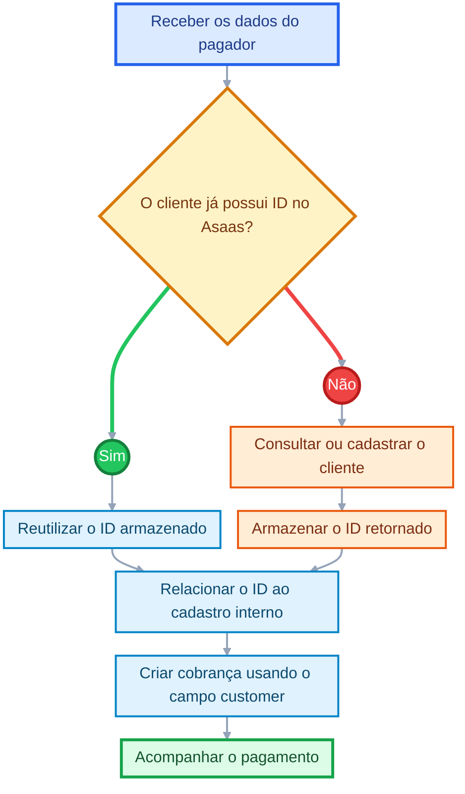
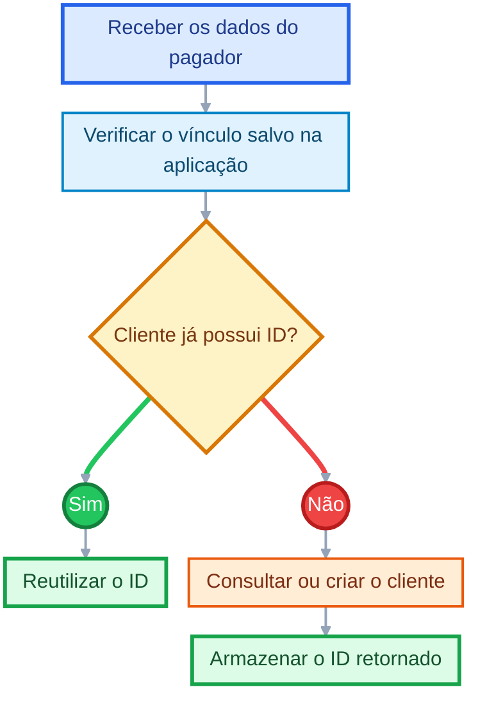

# Cadastro de clientes

Antes de criar uma cobrança, você precisa de um cliente.

Antes de criar uma cobrança ou assinatura, cadastre o pagador como cliente no Asaas.

Ao concluir a criação, a API retorna um identificador único, como `cus_000005219613`. Armazene esse ID na sua aplicação para utilizá-lo em cobranças, assinaturas, consultas e atualizações futuras.

<Callout icon="??" theme="info">
  ### **Importante**

  Ao concluir este guia, você terá cadastrado um cliente, armazenado seu identificador e preparado a integração para criar cobranças vinculadas a ele.
</Callout>

<Embed title="" typeOfEmbed="youtube" url="https://www.youtube.com/watch?v=mxt0OAP2AqY" href="https://www.youtube.com/watch?v=mxt0OAP2AqY" html="%3Ciframe%20class%3D%22embedly-embed%22%20src%3D%22%2F%2Fcdn.embedly.com%2Fwidgets%2Fmedia.html%3Fsrc%3Dhttps%253A%252F%252Fwww.youtube.com%252Fembed%252Fmxt0OAP2AqY%253Ffeature%253Doembed%26display_name%3DYouTube%26url%3Dhttps%253A%252F%252Fwww.youtube.com%252Fwatch%253Fv%253Dmxt0OAP2AqY%26image%3Dhttps%253A%252F%252Fi.ytimg.com%252Fvi%252Fmxt0OAP2AqY%252Fhqdefault.jpg%26key%3D7788cb384c9f4d5dbbdbeffd9fe4b92f%26type%3Dtext%252Fhtml%26schema%3Dyoutube%22%20width%3D%22854%22%20height%3D%22480%22%20scrolling%3D%22no%22%20title%3D%22YouTube%20embed%22%20frameborder%3D%220%22%20allow%3D%22autoplay%3B%20fullscreen%3B%20encrypted-media%3B%20picture-in-picture%3B%22%20allowfullscreen%3D%22true%22%3E%3C%2Fiframe%3E" />

## Quando utilizar

Crie um cliente quando sua integração precisar registrar um pagador para:

* criar cobranças;
* criar assinaturas;
* reutilizar os dados cadastrais em operações futuras;
* consultar ou atualizar informações do pagador;
* relacionar o cadastro do Asaas ao cliente do seu sistema.

Caso o cliente já tenha sido cadastrado, reutilize o ID armazenado pela sua aplicação ou consulte os clientes existentes antes de criar um novo registro.

## Antes de começar

Defina:

* quais dados do cliente serão enviados;
* qual identificador do seu sistema será informado em `externalReference`;
* se o cliente receberá notificações do Asaas;
* onde o ID retornado será armazenado;
* como sua integração evitará cadastros duplicados.

## Como funciona



## 1. Verifique se o cliente já existe

Antes de criar um cadastro, verifique se sua aplicação já possui o ID do cliente no Asaas.

Quando necessário, consulte os clientes existentes pelo endpoint:

<Anchor target="_blank" href="https://docs.asaas.com/reference/listar-clientes">Listar clientes</Anchor>

Essa verificação é especialmente importante em fluxos com:

* retentativas automáticas;
* reprocessamento de pedidos;
* filas assíncronas;
* clientes recebidos por diferentes canais;
* operações que podem ser executadas mais de uma vez.

## 2. Crie o cliente

Envie uma requisição para:

```http
POST /v3/customers
```

<Anchor target="_blank" href="https://docs.asaas.com/reference/criar-novo-cliente">Consulte o endpoint: Criar novo cliente</Anchor>.

### Exemplo de requisição

```json
{
  "name": "Marcelo Almeida",
  "cpfCnpj": "24971563792",
  "mobilePhone": "4799376637"
}
```

## Campos importantes

| Campo                  | Finalidade                                             |
| ---------------------- | ------------------------------------------------------ |
| `name`                 | Nome do cliente                                        |
| `cpfCnpj`              | CPF ou CNPJ do cliente                                 |
| `email`                | E-mail utilizado nas comunicações                      |
| `mobilePhone`          | Número de celular do cliente                           |
| `externalReference`    | Identificador do cliente no seu sistema                |
| `notificationDisabled` | Define se as notificações do Asaas serão desabilitadas |
| `additionalEmails`     | E-mails adicionais que podem receber notificações      |

Consulte a referência do endpoint para verificar todos os campos aceitos, formatos e regras de preenchimento.

<Callout icon="??" theme="okay">
  ### **Recomendado**

  Utilize `externalReference` para relacionar o cliente do Asaas ao identificador utilizado pela sua aplicação.
</Callout>

## 3. Armazene o ID retornado

Após criar o cliente, a API retorna os dados cadastrados e o identificador do recurso.

### Exemplo simplificado de resposta

```json
{
  "id": "cus_000005219613",
  "name": "Marcelo Almeida",
  "cpfCnpj": "24971563792"
}
```

Armazene o valor retornado em `id`.

Esse identificador deve ser enviado no campo `customer` ao criar uma cobrança ou assinatura para o cliente.

Exemplo:

```json
{
  "customer": "cus_000005219613",
  "billingType": "PIX",
  "value": 100,
  "dueDate": "2026-08-15"
}
```

<Anchor target="_blank" href="https://docs.asaas.com/reference/criar-nova-cobranca">Consulte o endpoint: Criar nova cobrança</Anchor>.

## Evite clientes duplicados

<Callout icon="??" theme="warn">
  ### **Atenção**

  O Asaas permite a criação de clientes duplicados.

  Para evitar duplicidades, armazene o ID retornado ou consulte os clientes existentes antes de criar um novo cadastro.
</Callout>

Uma estratégia recomendada é:



Não crie um novo cliente para cada cobrança do mesmo pagador.

## Confirme o resultado

Após a requisição, confirme se:

* a resposta retornou o campo `id`;
* os dados foram cadastrados corretamente;
* o ID foi armazenado pela sua aplicação;
* o cadastro foi relacionado ao cliente do seu sistema;
* as configurações de notificação estão de acordo com a jornada desejada.

## Caso o cliente não seja criado

Verifique se:

* os dados estão no formato esperado;
* o CPF ou CNPJ foi informado corretamente;
* o e-mail e o telefone são válidos;
* a URL e a chave de API pertencem ao mesmo ambiente;
* todos os campos obrigatórios foram enviados;
* o cliente não foi criado em uma tentativa anterior.

<Callout icon="??" theme="warn">
  ### **Atenção**

  Em caso de timeout ou resposta inconclusiva, consulte os clientes existentes antes de repetir a criação.

  Reenviar a requisição sem essa verificação pode gerar um cadastro duplicado.
</Callout>

## Boas práticas

* Armazene o ID retornado pela API.
* Utilize `externalReference` para facilitar a conciliação.
* Valide CPF ou CNPJ, e-mail e telefone antes do envio.
* Reutilize o cliente nas próximas cobranças e assinaturas.
* Não dependa apenas de CPF, CNPJ ou e-mail como vínculo interno.
* Registre a relação entre o ID do Asaas e o ID da sua aplicação.
* Revise as configurações de notificação para evitar comunicações duplicadas.

## Referência da API

<Callout icon="??" theme="info">
  ### Importante

  Consulte a referência completa do endpoint `POST /v3/customers` para conhecer todos os campos, formatos e respostas disponíveis.

  <Anchor target="_blank" href="https://docs.asaas.com/reference/criar-novo-cliente">Acesse o endpoint: Criar novo cliente</Anchor>
</Callout>

## Próximos passos

* <Anchor target="_blank" href="https://docs.asaas.com/docs/guia-de-cobrancas">Conheça o fluxo de cobranças</Anchor>
* <Anchor target="_blank" href="https://docs.asaas.com/reference/criar-nova-cobranca">Crie uma nova cobrança</Anchor>
* <Anchor target="_blank" href="https://docs.asaas.com/docs/cobrancas-via-boleto">Crie cobranças via boleto</Anchor>
* <Anchor target="_blank" href="https://docs.asaas.com/docs/cobrancas-via-pix">Crie cobranças via Pix</Anchor>
* <Anchor target="_blank" href="https://docs.asaas.com/docs/cobrancas-via-cartao-de-credito">Crie cobranças via cartão de crédito</Anchor>
* <Anchor target="_blank" href="https://docs.asaas.com/docs/notificacoes">Configure as notificações</Anchor>
* <Anchor target="_blank" href="https://docs.asaas.com/docs/webhooks-2">Configure Webhooks</Anchor>

# Sibling pages

* [Introdução - Cobranças](https://docs.asaas.com/docs/guia-de-cobrancas.md)
* [Cobranças via boleto](https://docs.asaas.com/docs/cobrancas-via-boleto.md)
* [Cobranças via cartão de crédito](https://docs.asaas.com/docs/cobrancas-via-cartao-de-credito.md)
* [Criar uma cobrança parcelada](https://docs.asaas.com/docs/criar-uma-cobranca-parcelada.md)
* [Redirecionamento após o pagamento](https://docs.asaas.com/docs/redirecionamento-apos-o-pagamento.md)
* [Chargeback](https://docs.asaas.com/docs/chargeback.md)
* [Estornos](https://docs.asaas.com/docs/estornos.md)